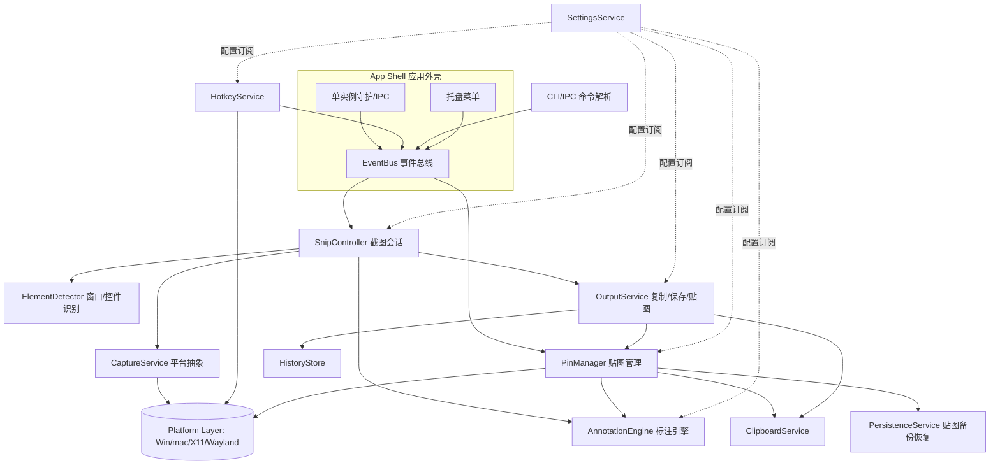
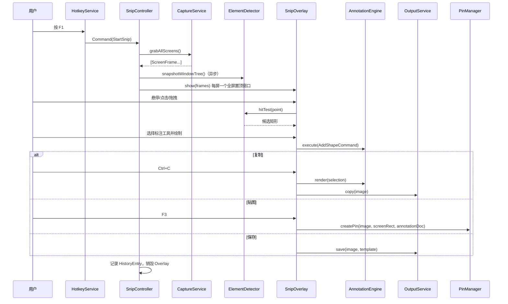
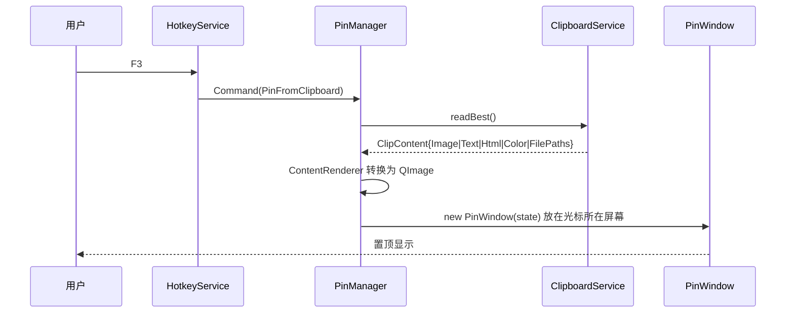
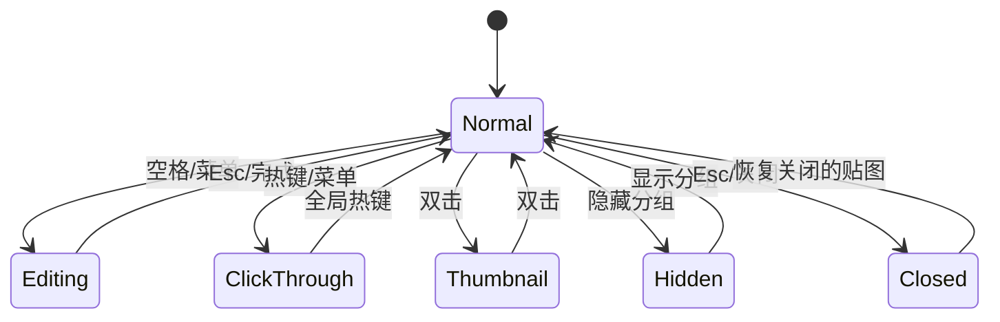

# PinShot：类 Snipaste 截图/贴图工具 净室（Clean-room）实现设计文档

> 版本：v1.0（2026-10-11）
> 声明：本文档描述的是**我们自研的工具 PinShot**。设计灵感仅来自 Snipaste 公开网站、公开文档/FAQ、GitHub 公开反馈仓库 Wiki 中描述的**用户可见行为**，以及同类开源工具的通用工程实践。本文**未**下载、运行、反编译或逆向任何 Snipaste 二进制，也**不**声称了解其私有源码结构、专有算法或二进制布局。所有架构、数据模型与算法均为本项目自行设计。

参考的公开资料（均已核对可访问）：
- 官网：https://www.snipaste.com/
- FAQ：https://www.snipaste.com/faq.html
- 公开反馈仓库 Wiki：https://github.com/Snipaste/feedback/wiki
- Getting Started：https://github.com/Snipaste/feedback/wiki/Getting-Started
- Key Bindings：https://github.com/Snipaste/feedback/wiki/Key-Bindings
- Command Line Options：https://github.com/Snipaste/feedback/wiki/Command-Line-Options
- 开源参考：Flameshot、ShareX、KDE Spectacle、Greenshot、ksnip（见第 15 节）

---

## 1. 概述与产品目标

PinShot 是一款常驻托盘的桌面效率工具，核心理念是“**截图 + 贴图**”：
- **截图（Snip）**：一键进入全屏冻结画面，智能识别窗口/控件边界或手动框选，即时标注后复制、保存或贴到屏幕。
- **贴图（Pin/Paste）**：把截图、剪贴板中的图片/文本/颜色值变成**置顶浮动窗口**，可缩放、旋转、翻转、调整透明度、鼠标穿透、分组隐藏，作为“屏幕便签”参照使用。
- **标注（Annotate）**：在截图阶段或贴图窗口上进行矩形、椭圆、箭头、画笔、马克笔、马赛克、模糊、文字、序号等标注，支持撤销/重做。

产品目标：
1. **极速**：热键到出现截图界面 < 150 ms（冷启动后常驻）；贴图创建 < 50 ms。
2. **低打扰**：无主窗口，托盘 + 热键驱动；不联网、不收集数据。
3. **精准**：像素级放大镜、取色器、HiDPI 与多显示器混合缩放下坐标正确。
4. **跨平台**：Windows 10/11 优先，macOS 12+ 与 Linux（X11 / Wayland）其次。
5. **可扩展**：插件式标注工具、输出目标（Output Sink）与命令行接口。

非目标（v1）：视频录制、云上传、OCR（列为扩展点）。

---

## 2. 推荐技术栈

| 层 | 选择 | 理由 |
|---|---|---|
| 语言/UI | **C++17/20 + Qt 6**（主推）；原型可用 Python + PySide6 | Qt 提供跨平台窗口、QPainter 矢量渲染、高 DPI 支持、剪贴板、托盘；C++ 保证启动与绘制性能；PySide6 适合快速验证交互 |
| 构建 | CMake + vcpkg/Conan | 跨平台依赖管理 |
| Windows 截屏 | **Windows Graphics Capture（WGC）**、**DXGI Desktop Duplication**，GDI BitBlt 兜底 | DXGI 对整屏冻结最快且支持多显卡输出；WGC 支持单窗口捕获与无黄框（Win11）；BitBlt 兼容老系统 |
| Windows 窗口识别 | UI Automation（UIA）+ `EnumWindows`/`DwmGetWindowAttribute(DWMWA_EXTENDED_FRAME_BOUNDS)` | 获取窗口去阴影真实边框和控件元素矩形 |
| macOS 截屏 | **ScreenCaptureKit**（12.3+），`CGWindowListCreateImage` 兜底（新系统已弃用） | 官方现代 API，支持 Retina、窗口列表、权限管理 |
| macOS 窗口识别 | `CGWindowListCopyWindowInfo` + Accessibility API（AXUIElement） | 窗口与控件边界 |
| Linux X11 | XCB/XShm（`xcb_shm_get_image`）、`_NET_CLIENT_LIST` 枚举窗口 | 快速共享内存截取 |
| Linux Wayland | **xdg-desktop-portal Screenshot / ScreenCast（PipeWire）** | Wayland 安全模型禁止直接读屏，必须走 Portal；全局热键走 GlobalShortcuts portal |
| 全局热键 | Win：`RegisterHotKey`；mac：Carbon `RegisterEventHotKey` 或 CGEventTap；X11：`XGrabKey`；Wayland：Portal | 各平台原生方案，封装为统一接口 |
| 图像处理 | Qt QImage + 自写 SIMD 盒式/高斯模糊；可选 OpenCV（仅模糊/边缘检测） | 控制依赖体积 |
| GIF 编码 | giflib 或 gifski（Rust, AGPL 注意）/ 自研 NeuQuant 量化 | 贴图导出动画或解码 GIF 贴图 |
| 配置 | INI（QSettings）或 TOML | 人类可读、便于便携版 |
| 测试 | GoogleTest / Qt Test，截图回归用像素比对 | |

为何选择 Qt：截图遮罩、贴图窗口本质是大量“无边框、置顶、透明、自绘”窗口，Qt 的 `Qt::FramelessWindowHint | Qt::WindowStaysOnTopHint | Qt::Tool` 和 `WA_TranslucentBackground` 跨平台一致性最好；Flameshot 等成熟工具已证明可行。

---

## 3. 高层软件架构



分层（自底向上）：
1. **Platform Layer**：截屏、热键、窗口属性（置顶、穿透、排除捕获）、DPI 查询的原生实现。
2. **Core Services**：Capture、Clipboard、Hotkey、Settings、History、Persistence。
3. **Domain**：SnipSession、PinWindow 模型、AnnotationDocument（纯数据 + 命令栈）。
4. **UI**：SnipOverlay（全屏遮罩）、PinWindow（贴图视图）、Toolbar、Magnifier、SettingsDialog。
5. **App Shell**：单实例、托盘、事件总线、CLI。

---

## 4. 模块边界与职责

| 模块 | 负责（Owns） | 不得负责（Must NOT own） |
|---|---|---|
| App Shell | 进程生命周期、单实例锁（QLocalServer/命名管道）、托盘、模块装配（依赖注入） | 任何业务逻辑、绘图 |
| HotkeyService | 注册/注销全局热键、冲突检测、把按键映射为 `Command` 事件 | 执行命令本身；知道截图如何实现 |
| CaptureService | 按显示器返回冻结帧 `ScreenFrame`（像素 + 物理/逻辑几何 + DPI）、窗口截图 | UI 显示、选区逻辑、编码保存 |
| ElementDetector | 给定屏幕点返回候选矩形层级（窗口→子控件） | 截屏像素 |
| SnipController / SnipOverlay | 一次截图会话：选区状态机、放大镜、取色、工具栏、调用标注引擎 | 剪贴板细节、文件格式、贴图窗口生命周期 |
| AnnotationEngine | 标注对象模型、命令栈（撤销/重做）、渲染到 QPainter、导出合成图 | 窗口管理、文件 IO |
| PinManager | 所有贴图窗口的创建、销毁、分组、隐藏/显示、关闭历史（可恢复） | 截屏、原生热键 |
| PinWindow | 单个贴图的显示与交互：缩放、旋转、翻转、透明度、穿透、阴影、进入标注 | 跨贴图协调（交给 PinManager） |
| ClipboardService | 读写图片/文本/HTML/颜色，多格式（PNG、DIB、text/uri-list） | 决定写什么（由调用方决定） |
| OutputService | 复制、保存（文件名模板、格式、质量）、快速保存目录、自动保存 | 标注编辑 |
| HistoryStore | 截图历史（选区与图像）、可回溯上一次截图区域 | UI |
| PersistenceService | 贴图会话的序列化与启动恢复 | 业务规则 |
| SettingsService | 配置读写、默认值、迁移、变更通知 | 直接操作 UI |

原则：模块之间通过**接口 + 事件总线**通信，UI 只依赖 Domain 与 Service 接口；Platform 层对上层只暴露抽象接口（`ICaptureBackend`、`IHotkeyBackend`、`IWindowEffects`）。

---

## 5. 功能清单（依据公开文档描述的可见行为，按 PinShot 自身边界划分）

### 5.1 截图（Snip）
- 热键（默认 F1，与公开文档描述的默认习惯一致）进入截图；冻结所有屏幕。
- **自动检测窗口与界面元素**：鼠标悬停高亮窗口/控件矩形，单击直接选中；拖拽自定义选区。
- 选区微调：拖动八个手柄；方向键移动 1px，配合修饰键调整边缘（如 Ctrl/Shift+方向键）。
- **放大镜**：显示鼠标周边像素网格、坐标、选区尺寸、当前像素颜色；按键在 RGB/HEX 间切换，按 C 复制颜色值。
- **回溯历史选区**：按 `,` / `.` 切换到历史截图记录（公开文档中描述了类似功能）。
- 截图输出：复制（Ctrl+C / Enter）、保存（Ctrl+S）、快速保存、贴图（F3 / Ctrl+T 之类）、取消（Esc / 右键）。
- 延时截图、截取上一次区域、全屏截图（作为 CLI/托盘命令）。

**边界**：截图会话结束即销毁 Overlay；跨会话只保留 HistoryEntry。

### 5.2 贴图（Pin / Paste）
- 截图直接贴到屏幕原位置。
- **剪贴板贴图**（默认 F3）：剪贴板内容可为图像、纯文本（渲染为文本图片）、HTML 富文本、颜色值（生成色块）、图片文件路径。
- 贴图窗口操作：滚轮缩放（以光标为中心）、Ctrl+滚轮调透明度、拖动移动、1/2 键旋转、3/4 键水平/垂直翻转（键位为我们的设计）、双击/Esc 关闭、右键菜单。
- **鼠标穿透（click-through）**：贴图不再接收鼠标，可透过它操作下层窗口；需要全局热键切回。
- **缩略图模式**：双击收缩为小缩略条。
- **分组**：贴图属于某组，一键隐藏/显示当前组、切换组。
- 关闭后可恢复（关闭历史）；退出时备份、下次启动恢复。
- 贴图中可再次截图（贴图本身可被“截图”识别为窗口）。
- 支持 GIF 动图贴图播放（扩展：内置解码）。

### 5.3 标注（Annotate）
矩形、椭圆、折线/直线、箭头、画笔、马克笔（半透明荧光）、马赛克、高斯模糊、文字、序号标记、橡皮擦；线宽/颜色/填充；撤销/重做；按住 Shift 约束比例/角度。截图阶段与贴图阶段共享同一引擎。

### 5.4 取色器
截图状态下取任意屏幕像素；贴图中也可取色；颜色值可直接作为“颜色贴图”。

### 5.5 多显示器与 HiDPI
支持跨屏选区；每屏不同缩放比（100%/150%/200%）下坐标精确；输出图按物理像素保存，可选按逻辑尺寸缩放。

### 5.6 其他
托盘菜单、开机自启、便携模式（配置放程序目录）、多语言、主题、命令行接口（第 12 节）、提示音、免打扰（全屏游戏时禁用热键）。

---

## 6. 核心流程

### 6.1 开始截图 → 选区 → 复制/贴图/标注/保存



要点：
- **先截后显**：必须在显示遮罩前完成截屏，避免遮罩自身被截入；同时调用平台 API 把 Overlay/贴图窗口从捕获中排除（Win: `SetWindowDisplayAffinity(WDA_EXCLUDEFROMCAPTURE)`；mac: `NSWindow.sharingType = .none`）。
- 窗口树快照在冻结时刻获取，保证高亮矩形与冻结画面一致。
- 选区状态机：`Idle → Hovering → Dragging → Selected → Editing(Tool) → Finished/Cancelled`。

### 6.2 热键从剪贴板贴图


优先级：图像 > 图片文件路径 > HTML > 颜色字符串（`#RRGGBB`/`rgb()`）> 纯文本。若剪贴板为空或不可识别，则重新显示“最近关闭的贴图”。

### 6.3 贴图上标注 → 撤销/重做 → 复制/保存
1. 用户在贴图上按空格或右键“标注”，PinWindow 进入编辑模式，弹出附着工具栏。
2. 标注坐标存储在**贴图图像坐标系**（未旋转、未缩放），视图通过变换矩阵显示，因此缩放/旋转后标注仍对齐。
3. 每次操作生成 `Command` 压入该贴图独立的 `UndoStack`（Ctrl+Z / Ctrl+Y）。
4. 退出编辑时标注保留为矢量层；复制/保存时 `AnnotationEngine::flatten(baseImage, doc)` 合成栅格图，再应用旋转/翻转。

### 6.4 鼠标穿透、透明度、缩放/旋转/翻转
- **透明度**：`setWindowOpacity()`，步长 10%，下限 10%。
- **缩放**：视图变换 `scale ∈ [0.1, 10]`，以光标为锚点：新窗口位置 = 光标 −（光标 − 原位置）× 新比例/旧比例；窗口尺寸跟随调整。
- **旋转/翻转**：维护 `QTransform`（90° 步进 + 镜像），窗口外接矩形重算。
- **穿透**：Win 加 `WS_EX_TRANSPARENT | WS_EX_LAYERED`；mac `ignoresMouseEvents = YES`；X11 用 XShape 设空输入区域；Qt 6 可用 `Qt::WindowTransparentForInput`。穿透后贴图无法再接收热键与点击，故需全局热键“切换穿透/恢复全部”，并在托盘提供入口。



---

## 7. 模块连接：接口与事件

```cpp
// 平台抽象
struct ScreenFrame { QImage image; QRect physicalGeom; QRectF logicalGeom; qreal dpr; QString screenId; };
class ICaptureBackend {
public:
  virtual std::vector<ScreenFrame> grabAll() = 0;
  virtual std::optional<QImage> grabWindow(WindowId) = 0;
  virtual ~ICaptureBackend() = default;
};
class IElementDetector { public: virtual std::vector<QRect> hitTest(QPoint globalPhys) = 0; };
class IWindowEffects {
public:
  virtual void setClickThrough(QWindow*, bool) = 0;
  virtual void setExcludeFromCapture(QWindow*, bool) = 0;
  virtual void setTopmost(QWindow*, bool) = 0;
};
class IHotkeyBackend { public: virtual bool reg(HotkeyId, QKeySequence) = 0; virtual void unreg(HotkeyId) = 0; };

// 服务
class ClipboardService { public: ClipContent readBest(); void writeImage(const QImage&); void writeText(const QString&); };
class PinManager { public: PinId createPin(PinCreateParams); void closePin(PinId); void restoreLastClosed();
                   void setGroupVisible(GroupId, bool); void toggleClickThroughAll(); };
class OutputService { public: void copy(const QImage&); QString save(const QImage&, SaveOptions); };
```

事件总线（Qt 信号或轻量 pub/sub），主要事件：

| 事件 | 发布者 | 订阅者 |
|---|---|---|
| `CommandRequested(Command, args)` | Hotkey / CLI / Tray | AppShell 路由到控制器 |
| `SnipFinished(SnipResult)` | SnipController | History、Output、PinManager |
| `PinCreated/PinClosed(PinId)` | PinManager | Persistence、Tray（计数） |
| `SettingsChanged(key)` | SettingsService | 所有相关模块 |
| `ScreensChanged` | Platform | Capture、PinManager（把屏外贴图拉回） |

命令 `Command` 枚举是热键、CLI、托盘菜单的统一入口，确保三者行为一致。

---

## 8. 数据模型

```cpp
struct ScreenshotSession {
  QUuid id; QDateTime startedAt;
  std::vector<ScreenFrame> frames;      // 冻结帧
  QRect virtualDesktopPhys;             // 所有屏幕并集（物理像素）
  QRect selectionPhys;                  // 当前选区
  std::vector<QRect> candidateRects;    // 元素检测结果缓存
  AnnotationDocument annotations;
  SnipState state;                      // Idle/Hovering/Dragging/Selected/Editing
};

struct PinWindowState {
  QUuid id; QString groupId;
  QImage source;                        // 原始图像（未标注）
  AnnotationDocument annotations;
  QPointF posLogical; QString screenId;
  qreal scale = 1.0; int rotation90 = 0; bool flipH=false, flipV=false;
  qreal opacity = 1.0; bool clickThrough=false, thumbnail=false, hidden=false, shadow=true;
  ContentKind kind;                     // Image/Text/Html/Color/Gif
  QString sourceText;                   // 文本类贴图可重新渲染
  QDateTime createdAt;
};

struct AnnotationItem {                 // 多态：Rect/Ellipse/Arrow/Pen/Marker/Mosaic/Blur/Text/Number
  QUuid id; ToolKind kind; QPen pen; QBrush brush;
  std::vector<QPointF> points;          // 图像坐标
  QVariantMap props;                    // 字体、文字、模糊半径、马赛克块大小、序号等
};
struct AnnotationLayer { QString name; bool visible=true; std::vector<AnnotationItem> items; };
struct AnnotationDocument { std::vector<AnnotationLayer> layers; UndoStack undo; };

struct HistoryEntry {
  QUuid id; QDateTime time; QRect selectionPhys; QString screenId;
  QString imagePath;                    // 历史缓存目录中的 PNG
  QString annotationsJsonPath;
};

struct Settings {
  General general;   // 语言、自启、便携、托盘图标
  SnipPrefs snip;    // 元素检测开关、放大镜、默认颜色格式、遮罩透明度
  PinPrefs pin;      // 默认阴影、透明度步长、缩放平滑、退出时备份
  OutputPrefs out;   // 保存目录、文件名模板 "PinShot_$yyyyMMdd_HHmmss$"、格式、JPEG 质量、自动复制
  std::map<Command, QKeySequence> hotkeys;
  AnnotationPrefs anno; // 每个工具的默认颜色/线宽
  int schemaVersion = 1;
};
```

---

## 9. 平台相关：截屏与窗口

### 9.1 多屏与 DPI
- 统一用**物理像素虚拟桌面坐标**作为内部真值，只在 UI 绘制时换算逻辑坐标。Windows 进程需声明 **Per-Monitor DPI Aware V2**（manifest），否则系统会虚拟化坐标导致截图模糊或错位。
- 每块屏幕创建一个独立 Overlay 窗口（而非一个跨屏大窗），避免混合 DPI 下 Qt 缩放错乱；跨屏选区由 SnipController 在物理坐标上维护，各 Overlay 只绘制与自身相交部分。
- 输出图像：选区跨越不同 DPI 的屏幕时，以物理像素拼接；设置项可选择“按最高 DPI 重采样”。
- 贴图在不同 DPI 屏间拖动时，保持“物理像素 1:1”或“逻辑尺寸不变”可配置（默认物理 1:1，使截图原样还原）。

### 9.2 Windows
- 冻结：DXGI Desktop Duplication 每个 Output `AcquireNextFrame` → 拷贝到 staging texture → QImage；HDR 屏需色调映射到 sRGB。
- 窗口检测：`EnumWindows`（按 Z 序）过滤不可见/cloaked（`DWMWA_CLOAKED`）窗口；控件用 UIA `ElementFromPoint`，在冻结时刻预缓存顶层窗口树，控件按需查询并加超时（50ms）。
- 置顶：`HWND_TOPMOST`；全屏独占程序上需定期重申置顶。
- 贴图窗口使用 `WS_EX_TOOLWINDOW` 不出现在任务栏 / Alt+Tab。

### 9.3 macOS
- 需屏幕录制权限（TCC），首次启动引导；ScreenCaptureKit `SCScreenshotManager` 获取各 display 图像。
- 置顶：`NSWindow.level = .floating` 或 `.screenSaver`（覆盖菜单栏）；`collectionBehavior` 加 `.canJoinAllSpaces | .fullScreenAuxiliary` 使贴图在所有 Space 可见。
- 热键需辅助功能权限（若使用 Event Tap）。

### 9.4 Linux
- X11：XShm 截取根窗口；`_NET_WM_STATE_ABOVE` 置顶；XShape 输入区域实现穿透。
- Wayland：截图只能通过 Portal（会出现系统确认对话框，无法“静默冻结”）；全局坐标与窗口定位受限，贴图位置由合成器决定。KDE/Hyprland 等可选 layer-shell（`wlr-layer-shell`）实现置顶。文档中应明确 Wayland 为“降级支持”。

---

## 10. 标注工具实现方案

**总体：矢量对象层 + 按需栅格化**。
- 每个标注是可编辑对象（可选中、移动、改色、删除），直到导出才合成。优点：撤销/重做廉价、缩放贴图不失真、可保存为工程（JSON）。
- 渲染管线：`base image → 滤镜类对象（马赛克/模糊，按 Z 序读取其下方合成结果）→ 形状/文字`。滤镜类需要读取“当前下层像素”，实现上维护一个缓存的合成位图，在对象变化时增量重绘脏区域。

| 工具 | 实现要点 |
|---|---|
| 矩形/椭圆 | 两点定义；Shift 约束正方/正圆；可选填充、圆角 |
| 直线/箭头 | 箭头头部为按线宽比例的三角形路径；支持渐粗箭身（多边形）；Shift 吸附 15° |
| 画笔 | 记录点序列，Catmull-Rom/二次贝塞尔平滑；`QPainterPath` 绘制，圆形笔帽 |
| 马克笔 | 半透明 + `CompositionMode_Multiply`，整条笔划一次绘制避免重叠加深 |
| 马赛克 | 区域按块大小 N 取平均色；支持矩形区域或画笔式涂抹（笔刷路径作为掩码） |
| 模糊 | 三次盒式模糊近似高斯（O(n)，可 SIMD）；半径可调；掩码同上 |
| 文字 | 原地 `QTextEdit` 编辑，完成后转为文本对象；字体/字号/颜色/描边/背景 |
| 序号 | 自增圆形编号，删除后可选择重排 |
| 橡皮擦 | 对象级擦除（点击删除对象），而非像素擦除 |

撤销/重做：命令模式（`AddItem`、`ModifyItem(old,new)`、`RemoveItem`），可直接使用 `QUndoStack`；拖动过程中合并为单条命令（`mergeWith`）。

坐标：标注存储于源图像像素坐标；绘制时使用视图矩阵（缩放·旋转·翻转·DPR）。

---

## 11. 持久化

目录（遵循平台惯例，便携模式则放程序目录下 `data/`）：
- Windows：`%APPDATA%/PinShot/`；macOS：`~/Library/Application Support/PinShot/`；Linux：`$XDG_CONFIG_HOME/pinshot/` 与 `$XDG_DATA_HOME/pinshot/`。

```
PinShot/
  config.ini            # 偏好设置（QSettings INI）
  history/              # 截图历史：<uuid>.png + index.json（上限 N 条/MB，LRU 清理）
  pins/
    session.json        # 贴图备份清单
    <uuid>.png          # 源图
    <uuid>.anno.json    # 标注矢量
  closed/               # 最近关闭的贴图（可恢复，上限如 20 个）
```

`session.json` 示例：
```json
{
  "schemaVersion": 1,
  "savedAt": "2026-10-11T12:00:00+08:00",
  "pins": [
    {"id":"9f..","group":"default","kind":"image","image":"9f...png","annotations":"9f...anno.json",
     "screenId":"DISPLAY2","pos":[1320,240],"scale":0.8,"rotation90":1,"flipH":false,
     "opacity":0.9,"clickThrough":false,"thumbnail":false,"hidden":false}
  ]
}
```
- 写入采用“写临时文件 + 原子 rename”；退出与每次贴图变更后防抖（2 s）保存，崩溃后也能恢复。
- 恢复时若 `screenId` 不存在，则把贴图放到主屏可见区域。
- 设置迁移：`schemaVersion` 递增时执行迁移函数链。
- 隐私：提供“退出时清除历史”选项；历史缓存不上传任何地方。

`config.ini` 片段：
```ini
[General]
language=zh-Hans
autostart=true
[Hotkeys]
Snip=F1
PinFromClipboard=F3
ToggleAllPins=Shift+F3
ToggleClickThrough=Ctrl+Alt+T
[Output]
saveDir=~/Pictures/PinShot
fileNameTemplate=PinShot_$yyyyMMdd_HHmmss$
format=png
```

---

## 12. 热键与命令行设计

### 12.1 全局热键（默认值，用户可改）
UX 参照公开文档中描述的习惯（F1 截图、F3 贴图），具体键位为 PinShot 自行定义：

| 命令 | 默认 |
|---|---|
| 截图 | F1 |
| 截图并直接复制 / 延时截图 | 未绑定（可配置） |
| 从剪贴板贴图 | F3 |
| 隐藏/显示所有贴图 | Shift+F3 |
| 切换到下一分组 | 未绑定 |
| 切换全部贴图鼠标穿透 | 未绑定（建议 Ctrl+Alt+T） |
| 恢复最近关闭的贴图 | 未绑定 |

### 12.2 截图界面局部快捷键
Esc/右键取消；Enter/Ctrl+C 复制；Ctrl+S 保存；Ctrl+T 或 F3 贴图；方向键移动光标/选区；Ctrl+Z/Y 撤销重做；`,`/`.` 历史回溯；C 复制颜色；Shift 切换颜色格式；Tab 切换窗口/元素检测粒度；数字键 1~9 切换工具。

### 12.3 贴图窗口局部快捷键
滚轮缩放；Ctrl+滚轮透明度；1/2 旋转；3/4 翻转；空格进入标注；Ctrl+C 复制；Ctrl+S 保存；双击缩略；Esc/Ctrl+W 关闭；Ctrl+Shift+Z 恢复关闭。

### 12.4 CLI（通过单实例 IPC 转发给常驻进程）
```
pinshot snip [--delay 3] [--area x,y,w,h] [--output clipboard|file|pin] [--path out.png]
pinshot pin  [--file img.png | --clipboard | --text "..."] [--pos x,y] [--group work]
pinshot pins show|hide|toggle [--group NAME]
pinshot pins clickthrough on|off
pinshot settings open
pinshot quit
```
实现：首个进程持有 `QLocalServer("pinshot-<user>")`；后续调用连接并发送 JSON 命令 `{cmd, args}`，返回退出码。CLI 与热键共享 `Command` 路由。

---

## 13. 扩展点

1. **标注工具插件**：`IAnnotationTool { id(); icon(); createItem(); handleMouse(); paint(); serialize(); }`，注册到 ToolRegistry，工具栏自动出现。
2. **输出目标（Output Sink）**：`IOutputSink { name(); bool accept(const QImage&, Metadata); }`，可实现上传图床、发送到 IM、OCR 后复制文本。
3. **剪贴板内容渲染器**：`IContentRenderer` 处理新的 MIME（如 Markdown、SVG、LaTeX）。
4. **图像后处理管线**：保存前的过滤器链（加水印、圆角阴影、压缩）。
5. **脚本/IPC**：CLI JSON 协议对外公开，可被 AutoHotkey、Raycast、Shell 脚本调用。
6. **事件钩子**：`onSnipFinished`、`onPinCreated` 供插件订阅。
7. 插件以 Qt 插件（`QPluginLoader`）或进程外（JSON-RPC）形式加载，后者更安全。

---

## 14. 实施阶段

| 阶段 | 内容 | 验收 |
|---|---|---|
| P0 原型（2 周） | PySide6 或 Qt：单屏截图、框选、复制、托盘、F1 热键 | Windows 可用 |
| P1 MVP（4–6 周） | C++/Qt；多屏 + Per-Monitor DPI；窗口自动检测；放大镜/取色；保存模板；剪贴板贴图（图片/文本）；贴图缩放、透明度、拖动、关闭 | 混合 DPI 双屏像素精确 |
| P2 标注（4 周） | 标注引擎全部工具、撤销重做、截图与贴图共享；贴图旋转翻转 | 标注导出与屏幕显示一致 |
| P3 贴图高级（3 周） | 鼠标穿透、分组、缩略图、关闭恢复、会话备份恢复、历史回溯 | 崩溃后贴图恢复 |
| P4 平台扩展（4–6 周） | macOS ScreenCaptureKit、X11、Wayland Portal；控件级检测（UIA/AX） | 三平台 CI 构建 |
| P5 完整版 | CLI、GIF 贴图、HDR、多语言、插件 API、自动更新、安装包与签名 | 发布 1.0 |

质量保障：像素回归测试（固定画面截图比对）、DPI 矩阵测试（100/125/150/200%）、启动/截屏延迟基准、内存（大量贴图时图片以共享 QImage、缩略图降采样）。

---

## 15. 可参考的开源项目（仅学习通用工程做法，注意许可证）

| 项目 | 许可证 | 可学习点 |
|---|---|---|
| Flameshot（https://github.com/flameshot-org/flameshot） | GPL-3.0 | Qt 截图遮罩、标注工具插件化、CLI 与 D-Bus |
| ShareX（https://github.com/ShareX/ShareX） | GPL-3.0 | Windows 区域检测、输出工作流、上传目标 |
| KDE Spectacle（https://invent.kde.org/graphics/spectacle） | GPL-2.0+/LGPL | Wayland/KWin 截图、Portal |
| ksnip（https://github.com/ksnip/ksnip） + kImageAnnotator | GPL-3.0 / LGPL-3.0 | 跨平台标注库、贴图（Pin）窗口 |
| Greenshot（https://github.com/greenshot/greenshot） | GPL-3.0 | Windows 窗口捕获、编辑器 |
| obs-studio（https://github.com/obsproject/obs-studio） | GPL-2.0+ | WGC / DXGI / ScreenCaptureKit / PipeWire 捕获后端 |
| xdg-desktop-portal 文档（https://flatpak.github.io/xdg-desktop-portal/） | — | Wayland 截图与全局快捷键 |

许可证注意：若 PinShot 打算闭源或使用宽松许可证，**不得复制 GPL 代码**，只能阅读理解思路后独立实现；LGPL 库（如 kImageAnnotator）可动态链接使用但需遵守其条款。Qt 本身可用 LGPL-3.0（动态链接）或商业许可。

---

## 附录：净室流程建议
1. 规格团队只依据公开文档、官网截图与本文档编写功能规格；实现团队只依据规格编码。
2. 保留资料来源记录（URL 与访问日期），不接触任何第三方专有二进制的内部实现。
3. 产品名称、图标、UI 文案与配色自行设计，避免与 Snipaste 商标或视觉元素混淆。
